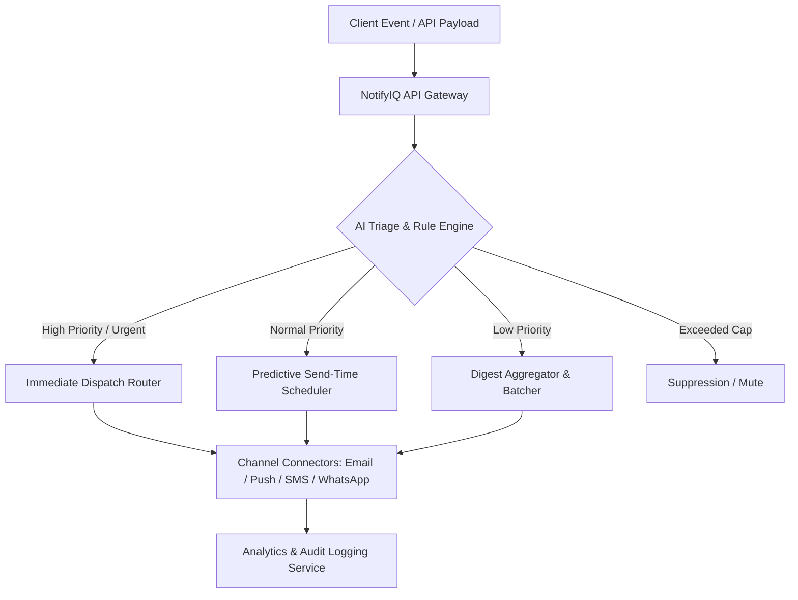

# Business Requirements Document (BRD)
## Project Name: NotifyIQ — Intelligent Notification Triage & Management System
**Organization**: BizEazer  
**Target Repository**: `BizEazer/NotifyIQ`  
**Document Status**: Approved  
**Version**: 1.0.0  
**Date**: August 2026  

---

## 1. Executive Summary

### 1.1 Purpose & Vision
**NotifyIQ** is an enterprise-grade AI-powered notification intelligence, routing, and triage system. Modern platforms face severe user notification fatigue, high unsubscribe rates, and fragmented delivery across channels (Email, SMS, Push, WhatsApp, In-App). NotifyIQ addresses these challenges by acting as a central orchestration layer that evaluates notification priority, optimizes delivery times, aggregates low-priority updates into digests, and provides real-time operational analytics.

### 1.2 Scope
This BRD covers the end-to-end business and technical requirements for NotifyIQ, including core feature specifications, AI-driven triage mechanisms, channel integration protocols, functional and non-functional requirements, data workflow, and system architecture.

---

## 2. Business Objectives & Strategic Goals

* **Notification Fatigue Reduction**: Decrease user opt-out/unsubscribe rates by up to 35% via intelligent rate-limiting and digest aggregation.
* **Open & Conversion Optimization**: Increase open rates by 25% using predictive AI send-time optimization and automated copy generation.
* **Unified Multi-Channel Routing**: Streamline notification dispatching across Email, Push, SMS, WhatsApp, and Webhooks through a single API.
* **Operational Monitoring**: Provide engineering and product management teams with real-time audit visibility into delivery failure rates, latencies, and drop signals.

---

## 3. Stakeholder & Target User Personas

| Persona | Role | Key Needs / Objectives |
| :--- | :--- | :--- |
| **Product Managers** | Strategy & Engagement | Wants notification performance metrics, send-time optimization, and A/B test copy variants. |
| **Engineering Teams** | Integration & Infrastructure | Requires clean REST/gRPC APIs, failover routing, low latency (<200ms), and automated retry logic. |
| **Operations & Support** | System Monitoring | Needs live logs, delivery failure alerts, payload debugging, and rate-limiting control. |
| **End Users** | Consumers | Desires relevant, timely notifications without feeling overwhelmed by spam or repetitive alerts. |

---

## 4. Key Features & Functional Requirements



### 4.1 AI-Powered Notification Triage & Routing
* **FR-1.1 Priority Classification**: Automatically categorize incoming notifications into four priority levels:
  1. `URGENT` — Security alerts, OTPs, critical operational updates (Immediate dispatch).
  2. `STANDARD` — System updates, transaction confirmations (Scheduled or queued dispatch).
  3. `DIGEST` — Marketing, general newsletters, activity summaries (Aggregated into daily/weekly digest).
  4. `MUTE` — Excess noise or redundant updates (Suppressed).
* **FR-1.2 Rule Engine & Overrides**: Allow administrators to create custom JSON/YAML rule sets to override AI decisions based on event tags, metadata, or user attributes.
* **FR-1.3 User Preference Management**: Support granular user-level channel preferences (e.g., User A prefers OTPs via WhatsApp and digests via Email).

### 4.2 Send-Time Optimization & Copy Recommendations
* **FR-2.1 Optimal Delivery Timing**: Machine learning model predicts each user's historical engagement window to deliver non-urgent notifications at peak interaction times.
* **FR-2.2 Copy Generation & Confidence Scoring**: Integrate LLMs (e.g., Gemini / Claude) to suggest notification headline and body variants tailored for character limits across Push, SMS, and WhatsApp.

### 4.3 Multi-Channel Dispatch & Resiliency
* **FR-3.1 Channel Connectors**:
  * **Push Notifications**: Firebase Cloud Messaging (FCM), Apple Push Notification service (APNs).
  * **Email**: Amazon SES, SendGrid, Mailgun.
  * **SMS & WhatsApp**: Twilio, Meta WhatsApp Business API.
  * **Webhooks & In-App**: Real-time WebSockets and custom HTTP webhooks.
* **FR-3.2 Fallback & Failover Routing**: Automatic channel fallback (e.g., if Push fails within 15 seconds, attempt SMS fallback).
* **FR-3.3 Rate Limiting & Throttling**: Configurable per-user and per-channel frequency caps (e.g., maximum 3 push notifications per hour).

### 4.4 Analytics, Auditing & Observability
* **FR-4.1 Real-Time Analytics Dashboard**: Visual metrics for delivery status (Sent, Delivered, Opened, Failed, Bounced, Suppressed).
* **FR-4.2 Audit & Traceability**: Full request-to-delivery tracing with unique `notification_id` and raw payload debugging logs.

---

## 5. Non-Functional Requirements (NFRs)

### 5.1 Performance & Latency
* **API Response Time**: Ingest notification requests within $\le 200\text{ms}$ (99th percentile).
* **Urgent Delivery Latency**: Dispatch `URGENT` notifications to channel providers within $\le 1.5\text{ seconds}$.

### 5.2 Scalability & Availability
* **System Throughput**: Support up to 10,000 requests/second during peak event surges.
* **High Availability**: 99.99% system uptime requirement with multi-region failover.

### 5.3 Security & Compliance
* **Data Protection**: Encryption in transit (TLS 1.3) and at rest (AES-256) for all notification payloads and user PII.
* **Regulatory Compliance**: GDPR, CCPA, and TCPA compliance for message opt-outs and data retention policies.

---

## 6. Project Deliverables & Folder Structure

```
notifyIQ/
├── docs/
│   └── BRD.md                   # Business Requirements Document
├── src/                         # Application source code
│   ├── api/                     # REST/gRPC endpoints
│   ├── triage/                  # AI classification engine
│   ├── channels/                # Multi-channel integrations
│   └── analytics/               # Metrics and log collector
├── tests/                       # Automated test suites
├── README.md                    # Project documentation
└── package.json / go.mod        # Dependency manifests
```

---

## 7. Approval & Sign-Off

| Name | Role | Date | Status |
| :--- | :--- | :--- | :--- |
| **BizEazer Tech Team** | Engineering Lead | August 2026 | Approved |
| **Product Operations** | Product Manager | August 2026 | Approved |
