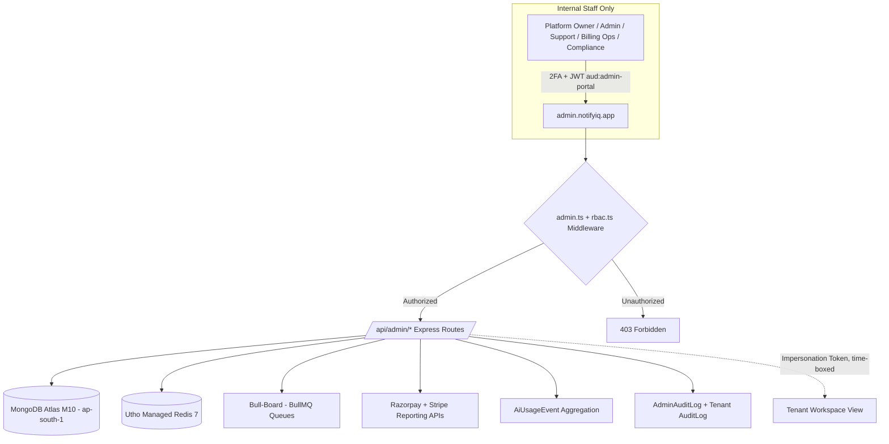

# Business Requirements Document (BRD)
## NotifyIQ — Platform Admin Portal (Super-Admin Console)
**Organization**: BizEazer Pvt Ltd
**Target Repository**: `BizEazer/NotifyIQ` (sub-module: `admin/`)
**Target Sub-domain**: `admin.notifyiq.app`
**Document Status**: Draft for Approval
**Version**: 1.0.0 — Mapped 1:1 to Issues #66–#108
**Date**: September 2026
**Depends On**: NotifyIQ Core Platform BRD v2.0.0 (Issues #1–#65)

---

## 1. Executive Summary & Purpose

The Core Platform BRD defines NotifyIQ's **tenant-facing** product — workspaces, agent inboxes, campaigns, and AI features consumed by SMBs, agencies, and SaaS partners. It deliberately excludes the tooling BizEazer's own internal team needs to **operate, monitor, bill, secure, and support** NotifyIQ as a multi-tenant SaaS business.

This document defines the **NotifyIQ Admin Portal** (working name: *"Mission Control"*) — a separate, internal-only application used exclusively by BizEazer platform staff (Platform Owners, Platform Admins, Support Agents, Billing Ops, Compliance Officers) to manage the entire NotifyIQ platform across all workspaces, agencies, and partner integrations.

The Admin Portal is architected as an **isolated application**: its own authentication realm, its own role model, and read/administrative access into the same MongoDB Atlas cluster and Redis/BullMQ infrastructure used by the core platform — but it is **never reachable by, or exposed to, any tenant user.**

### 1.1 Objectives
- Give BizEazer operations staff a single console to onboard, monitor, support, and (when necessary) suspend or offboard tenant workspaces.
- Reconcile revenue across both billing rails (Razorpay INR, Stripe USD/EUR) in one view.
- Monitor system health — BullMQ queues, MongoDB Atlas, Redis, Kubernetes pods — without direct database/cluster access.
- Track and control AI spend (Claude, Whisper, OpenAI embeddings) per workspace to protect unit economics.
- Centralize DPDP/GDPR compliance operations (erasure requests, audit trail review, data residency verification) across every workspace from one queue.
- Provide support staff a safe, audited way to see what a tenant sees ("login-as-workspace") without ever handling tenant credentials.
- Enforce strict internal RBAC — e.g., a Support Agent cannot issue refunds; a Billing Ops user cannot suspend a workspace.

### 1.2 Explicitly Out of Scope
- Any feature already delivered to tenants in the Core Platform BRD (agent inbox, campaign builder, RAG chatbot, flow builder, etc.) — the Admin Portal only observes/manages these, it does not reimplement them.
- Tenant-level workspace admin settings (managing your own team, your own WABA, your own templates) — that stays inside the core NotifyIQ app.
- Direct production database console access (`mongosh`, Compass) as a substitute for proper admin tooling — this portal is meant to replace ad-hoc DB access for day-to-day operations.

---

## 2. Admin Portal Architecture

The Admin Portal is a separate frontend (`admin.notifyiq.app`) and a protected set of backend routes under `/api/admin/*`, sharing the same MongoDB Atlas and Redis infrastructure as the core platform but isolated at the authentication and network layer.

### 2.1 Key Architectural Principles

| Principle | Description |
|---|---|
| **Isolated Auth Realm** | Admin users live in a dedicated `SuperAdmin` collection — never the tenant-scoped `User` collection — and issue a distinct JWT audience (`"aud": "admin-portal"`) that core-platform routes explicitly reject. |
| **Network Isolation** | `admin.notifyiq.app` resolves to a separate ingress with IP allow-listing and mandatory 2FA; never linked from, or discoverable through, the public marketing site or tenant app. |
| **Read-Mostly by Default** | Admin routes default to read-only aggregation queries; the small set of write actions (suspend, refund, impersonate, quota override) require explicit RBAC permission and are always double-logged. |
| **No Duplicated Business Logic** | Reuses the same internal services the core platform uses (e.g., the same `processContactDeletion` pipeline, the same Razorpay/Stripe SDK wrappers) rather than re-implementing billing or compliance logic — reducing drift. |
| **Defense in Depth on Impersonation** | "Login as workspace" never exposes or reuses a tenant's actual password/session; mints a short-lived, scope-limited impersonation token, requires a reason code, and is visibly banner-flagged in the UI. |

### 2.2 System Component Overview

| Layer | Component | Notes |
|---|---|---|
| Frontend | React Admin SPA (`admin.notifyiq.app`) | Separate build/deploy pipeline from tenant frontend; shares design system, not routes |
| Auth | `SuperAdmin` model + JWT (`aud: admin-portal`) + mandatory TOTP | Distinct from tenant `User`/JWT; never cross-valid |
| API | Express routes under `/api/admin/*` | Guarded by `admin.ts` + `rbac.ts` middleware, not tenant `auth.ts`/`workspace.ts` |
| Data | MongoDB Atlas M10 (ap-south-1) — same cluster, read-mostly aggregation queries | Heavy aggregations run against a read-preference secondary where available |
| Queue Visibility | Bull-Board mounted behind admin RBAC (not public) | Existing 8 queues from Core Platform Issue #31 |
| Billing | Razorpay + Stripe Admin/Reporting APIs via existing SDK wrappers | Reuses Core Platform Issues #48/#49 integration layer |
| AI Cost Telemetry | Usage/cost events emitted by Claude / Whisper / embeddings calls, aggregated per workspace | New lightweight `AiUsageEvent` collection |
| Audit | `AdminAuditLog` (admin actions) + existing tenant `AuditLog` (compliance events) | Both append-only, 7-year retention |

---

## 3. Detailed Functional Requirements & Feature Breakdown

Requirements are grouped into five phases (A–E), mapped 1:1 to **Issues #66–#108**, continuing directly from the Core Platform BRD's Issue #65.

---

### 3.1 Phase A: Admin Portal Core & Access (Issues #66 – #75)

#### FR-A.1 — Isolated Admin Application *(Issue #66)*
Stand up `admin.notifyiq.app` as a separate frontend deployment and `/api/admin/*` backend namespace.
- Separate CI/CD pipeline and container image from the tenant frontend/backend.
- No hyperlinks, redirects, or API references to this domain anywhere in the tenant-facing app or marketing site.
- Dedicated ingress/DNS entry with its own TLS certificate and, optionally, VPN-only or corporate-network-only exposure.
- Health-check endpoint separate from the tenant platform's, so admin-portal deploys/rollbacks never touch tenant uptime.

#### FR-A.2 — SuperAdmin Identity & RBAC *(Issue #67)*
- New `SuperAdmin` Mongoose model, fully decoupled from the tenant `User` collection (separate collection, separate password hash, separate indexes).
- `role` enum: `platform_owner`, `platform_admin`, `support_agent`, `billing_ops`, `compliance_officer`, `read_only_auditor`.
- `permissions: string[]` array of granular capability keys (e.g., `workspace:suspend`, `billing:refund`, `ai:set_caps`) checked by `rbac.ts` middleware on every mutating route.
- Support for **custom roles** composed from the same permission key set (see FR-A.9).
- Account lifecycle: invite-only creation (no public admin signup), forced password reset on first login, deactivation (not hard-delete) on offboarding to preserve audit-log integrity.

#### FR-A.3 — Mandatory 2FA *(Issue #68)*
- TOTP-based two-factor authentication enforced at first login for **every** `SuperAdmin` account — no bypass flag, no "remember this device forever."
- Standard TOTP apps supported (Google Authenticator, Authy, 1Password).
- Backup/recovery codes generated at enrollment, single-use, stored hashed.
- Admin JWT access-token life: 15 minutes (mirrors core platform token policy), refresh token stored server-side in Redis with revocation support.
- Failed 2FA attempts feed into the Security Center (FR-E.5) anomaly detection.

#### FR-A.4 — Admin Action Audit Trail *(Issue #69)*
- Append-only `AdminAuditLog` collection capturing, for every mutating action: actor (`superAdminId`), role at time of action, action type, target entity (workspace/user/invoice/etc.), **before/after diff**, source IP, user agent, and a mandatory free-text reason code.
- 7-year retention, matching the Core Platform's compliance audit standard (Issue #21/#30).
- No update or delete API exists for this collection — write-once, exportable only.

#### FR-A.5 — Access Hardening *(Issue #70)*
- Configurable IP allow-listing per admin account or per role (e.g., restrict Billing Ops to office/VPN CIDR ranges).
- Configurable idle-session timeout, default 20 minutes, auto-terminating stale sessions server-side (not just client-side hide).
- Optional stricter timeout tiers per role (e.g., Support Agent impersonation sessions always capped regardless of general idle setting).

#### FR-A.6 — Platform Dashboard *(Issue #71)*
Landing dashboard summarizing, at a glance:
- Total workspaces broken down by status: active / trial / suspended / churned.
- Active WABA connections and count nearing token expiry.
- Messages sent today / this month, trending against the prior period.
- Current MRR by currency (INR / USD / EUR), refreshed near-real-time.
- Queue health traffic-light (green/amber/red per BullMQ queue).
- Count of open DPDP/GDPR erasure requests and days-to-SLA-breach.
- Quick links into the relevant drill-down screen from every widget.

#### FR-A.7 — Global Search *(Issue #72)*
- Single search bar resolving a **workspace name**, **contact phone number**, or **user email** to the relevant workspace/record across the entire platform.
- Fuzzy/partial match on workspace name and slug; exact E.164 match on phone.
- Search results respect the searching admin's RBAC scope (e.g., a Support Agent sees workspace summary, not billing detail, in results).

#### FR-A.8 — Admin Notification Center *(Issue #73)*
- Real-time in-portal alert feed for: SLA breaches (erasure requests, uptime), queue backlogs/DLQ growth, failed payments, WABA quality-rating drops, and security anomalies.
- Optional forwarding of critical alerts to email and/or Slack webhook.
- Alerts are actionable — clicking one deep-links into the relevant management screen.

#### FR-A.9 — Role Management UI *(Issue #74)*
- Platform Owners can create and edit **custom admin roles**, selecting from the full permission-key catalog.
- Built-in roles (platform_owner, platform_admin, etc.) are protected from deletion but their permission sets can be viewed for reference when building new roles.
- Role changes themselves are logged to `AdminAuditLog`.

**Phase A Exit Criteria (Issue #75):** Admin login with 2FA is live; RBAC blocks unauthorized actions in automated tests; every mutating action produces an `AdminAuditLog` entry; dashboard renders live platform metrics.

---

### 3.2 Phase B: Tenant / Workspace Lifecycle Management (Issues #76 – #85)

#### FR-B.1 — Workspace 360° View *(Issue #76)*
- List view with filters (plan, status, currency, signup date range, agency vs. direct) and sortable columns.
- Detail view surfacing: plan & billing status, WABA connection status and quality tier, team size and roles, message volume trend (30/90-day sparkline), compliance flags (open erasure requests, consent gaps), and recent activity timeline.

#### FR-B.2 — Lifecycle Actions *(Issue #77)*
- **Suspend**: pauses campaign sending, disables new webhook processing, shows a maintenance banner to the tenant; reversible.
- **Reactivate**: restores full functionality; re-validates WABA token before re-enabling send.
- **Hard-delete**: cascades through the same deletion pipeline pattern as FR-1A.6 (Contact → Messages → Conversations) but at workspace scope, with a mandatory confirmation step and 24-hour cooling-off/undo window before permanent purge.
- Every lifecycle action requires a reason code and is fully audited.

#### FR-B.3 — Login-as-Workspace (Impersonation) *(Issue #78)*
- Consent-gated: either the tenant has an open support ticket, or an explicit reason code is logged justifying access without prior tenant contact.
- Time-boxed session, default 30 minutes, configurable up to 2 hours for complex investigations.
- Uses a scoped **impersonation token** — never the tenant's real password or session — minted server-side and bound to the admin's identity.
- Persistent, non-dismissible on-screen banner ("Viewing as [Workspace] — Support Session, ends in 14:32") visible throughout the impersonated session.
- Full read access to reproduce the tenant's issue; write actions during impersonation are optionally restricted by role (e.g., Support Agents can view but not send campaigns while impersonating, unless explicitly granted).
- Every impersonation session logs to **both** `AdminAuditLog` and the target workspace's own tenant `AuditLog`, so the action is visible in that workspace's own compliance history.

#### FR-B.4 — Plan & Quota Overrides *(Issue #79)*
- Manual override of plan tier, message-send quotas, and campaign throughput caps (up to Meta's 80 msg/sec ceiling) for negotiated enterprise deals — without a code deploy.
- Overrides are clearly flagged in the workspace detail view as "custom" vs. "standard plan default," with an expiry date option.

#### FR-B.5 — WABA Health Monitor *(Issue #80)*
- Per-workspace panel showing: access-token expiry countdown, Meta quality rating (Green/Yellow/Red), and current messaging-limit tier (250/1K/10K/100K/Unlimited).
- Proactive alerts (via FR-A.8) before token expiry or on quality-rating downgrade, so support can reach out before the tenant is impacted.

#### FR-B.6 — Onboarding Funnel Analytics *(Issue #81)*
- Funnel visualization of the Embedded Signup flow (FR-1A.1): started → Facebook login completed → WABA selected → System User created → permanent token obtained → webhook registered → workspace activated.
- Drop-off percentage at each step, filterable by date range and signup channel (direct / Zynkrit referral / Rolodiq referral).

#### FR-B.7 — Agency Hierarchy View *(Issue #82)*
- Expandable tree view of white-label agency parent workspaces and their child sub-workspaces (from `whitelabel.parentAgencyId`).
- Per-agency roll-up of aggregate usage (messages sent across all children) and aggregate revenue.
- Quick navigation from an agency node into any child workspace's own 360° view.

#### FR-B.8 — Internal Account Notes *(Issue #83)*
- Free-text notes and tag system attached to a workspace record (e.g., "Enterprise deal — renewal Nov 2026", "Escalation-prone").
- Visible to all admin staff with workspace-view permission; edit history preserved (who wrote what, when).

#### FR-B.9 — Bulk Operations *(Issue #84)*
- Bulk actions over a filtered workspace set, e.g., bulk-suspend all workspaces on an expired trial, or bulk-notify all workspaces on a plan being deprecated.
- Confirmation step showing exact affected-workspace count before execution; each individual action within the bulk operation is still separately audited.

**Phase B Exit Criteria (Issue #85):** A support agent can locate any workspace, view its full status, and safely impersonate it within 3 clicks; suspend/reactivate actions are reflected in the tenant app within NFR latency targets.

---

### 3.3 Phase C: Billing, Revenue & Financial Oversight (Issues #86 – #92)

#### FR-C.1 — Unified Billing Dashboard *(Issue #86)*
- Reconciles Razorpay (INR) and Stripe (USD/EUR) subscriptions, invoices, and payment events into one view — per workspace and platform-wide.
- Side-by-side status: current plan, next billing date, payment method on file (masked), last payment outcome.

#### FR-C.2 — Invoice & Refund Tooling *(Issue #87)*
- Manual invoice generation and adjustment through the **same** Razorpay/Stripe SDK wrappers the core platform uses (Issues #48/#49), avoiding logic drift.
- Full and partial refund issuance, with mandatory audit note explaining the reason.
- GST-compliant (HSN 998314) invoice formatting preserved on manually generated invoices.

#### FR-C.3 — Dunning Monitor *(Issue #88)*
- Cross-workspace view of accounts currently inside the 7-day payment-failure grace period (per Core Platform FR-1B.2).
- Manual retry trigger and escalation-to-suspension controls, with countdown to auto-suspension clearly shown.

#### FR-C.4 — Revenue Analytics *(Issue #89)*
- MRR, churn rate, and ARPU computed and charted, segmented by currency, plan tier, and acquisition channel (direct / Zynkrit / Rolodiq referral — tying back to Core Platform Issue #51's `?ref=rolodiq` tracking).
- Trend view (monthly) plus point-in-time snapshot.

#### FR-C.5 — GST/Tax Export *(Issue #90)*
- Generate GST-compliant (HSN 998314) statutory reports for the finance team, matching the invoicing format from Core Platform FR-1B.2.
- Equivalent VAT/sales-tax export for the Stripe (EUR/USD) side, formatted for the relevant jurisdiction's filing needs.

#### FR-C.6 — Credits & Coupons *(Issue #91)*
- Create and manage promotional credit grants and discount coupon codes, applicable at signup or renewal.
- Usage tracking per coupon (redemption count, total discount value issued).

**Phase C Exit Criteria (Issue #92):** Finance can reconcile a given month's revenue across both billing rails from the Admin Portal alone, without querying Razorpay/Stripe dashboards directly.

---

### 3.4 Phase D: System Health, AI Ops & Queue Monitoring (Issues #93 – #100)

#### FR-D.1 — Embedded Queue Monitoring *(Issue #93)*
- Bull-Board for all 8 BullMQ queues (`webhook-processor`, `campaign`, `audio-processor`, `sentiment-analysis`, `ai-reply`, `chatbot`, `segmentation`, `compliance` — from Core Platform Issue #31) mounted **behind Admin Portal RBAC**, replacing any standalone/public Bull-Board instance.
- Per-queue metrics: active, waiting, delayed, failed, completed job counts; retry inspection; manual job retry/removal for authorized roles.

#### FR-D.2 — Queue Health Alerts *(Issue #94)*
- Alert thresholds configurable per queue: jobs stalled beyond X minutes, or dead-letter/failed-job count exceeding Y.
- Routes into the Admin Notification Center (FR-A.8) with severity tagging.

#### FR-D.3 — AI Cost Dashboard *(Issue #95)*
- Aggregates spend from Claude (Haiku/Sonnet — sentiment analysis, reply suggestions), OpenAI Whisper (voice transcription), and OpenAI embeddings (RAG chatbot) per workspace and platform-wide.
- Breakdown by feature: sentiment analysis, reply suggestions, transcription, RAG chatbot — so cost drivers are visible at a glance.
- Trend view to catch runaway usage or abuse early.

#### FR-D.4 — AI Usage Caps *(Issue #96)*
- Platform Admins can set per-workspace or per-plan-tier AI usage caps (e.g., max transcription minutes/month, max chatbot queries/day).
- Automatic throttling once a cap is reached, with a tenant-facing upgrade prompt shown in the core app rather than a silent failure.

#### FR-D.5 — Prompt-Injection Review Queue *(Issue #97)*
- Surfaces conversations flagged by the Core Platform's prompt-injection shield (Issue #65 — the `<user_message>` XML-tag sanitization layer) for human review.
- Supports escalation actions: mark as false-positive, warn the workspace, or restrict the workspace's AI feature access pending investigation.

#### FR-D.6 — Incident & Status Page *(Issue #98)*
- Manage platform incident declarations (start/update/resolve) and the public status page shown to tenants during outages.
- Incident timeline auto-populates from declared updates; optional integration with the Admin Notification Center for internal visibility.

#### FR-D.7 — Infrastructure Health *(Issue #99)*
- Integrates MongoDB Atlas, Utho Redis, and Utho Kubernetes health/metrics APIs into a single infrastructure status panel — CPU/memory, connection pool saturation, pod restart counts, replica lag.

**Phase D Exit Criteria (Issue #100):** On-call staff can diagnose a queue backlog or AI cost spike from the Admin Portal without shelling into infrastructure directly.

---

### 3.5 Phase E: Compliance, Security & Reporting (Issues #101 – #108)

#### FR-E.1 — Central Erasure Queue *(Issue #101)*
- Aggregates all DPDP/GDPR data-erasure and data-export requests (Core Platform FR-1A.6 / FR-1B.3) across every workspace into one queue.
- SLA countdown against the 72-hour processing target (NFR-4 from the Core Platform BRD), with visual escalation as the deadline nears.
- Completion tracking and links to the generated export artifact (Utho Object Storage signed URL) or deletion confirmation.

#### FR-E.2 — Cross-Workspace Audit Viewer *(Issue #102)*
- Search/filter/export over the platform-wide, append-only audit trail — combining tenant `AuditLog` entries and `AdminAuditLog` entries into one queryable view.
- Filters: workspace, actor, action type, date range; export to CSV for legal/compliance requests.

#### FR-E.3 — Meta BSP Readiness Dashboard *(Issue #103)*
- Rolls up the metrics needed for the Core Platform's Meta Business Solution Provider application (Issue #62): 12-month message volume trend toward the 1M+/month target, SLA uptime tracking against the 99.9% target, and count of documented WABA case studies (target 50+).
- Single view showing "ready / not yet ready" status against each BSP requirement.

#### FR-E.4 — Data Residency Verification *(Issue #104)*
- Periodic automated checks confirming all workspace data remains hosted in the `ap-south-1` (Mumbai) region as required by DPDP (Core Platform NFR-4).
- Flags any anomaly (e.g., a misconfigured backup or replica outside the approved region) for immediate compliance review.

#### FR-E.5 — Security Center *(Issue #105)*
- Monitors failed admin login attempts and failed 2FA attempts across all `SuperAdmin` accounts.
- Anomaly detection: new IP address, unusual login hour, impossible-travel pattern.
- Reviewable log of active and past admin sessions, with the ability to force-terminate a suspicious active session.

#### FR-E.6 — Executive Reporting *(Issue #106)*
- Scheduled (weekly/monthly) and on-demand PDF/Excel export of platform KPIs — workspace growth, MRR, churn, AI cost trend, uptime — for leadership and board reporting.

#### FR-E.7 — Key Rotation Manager *(Issue #107)*
- Platform-wide view of all workspace API keys (Core Platform Issue #20) and Meta webhook secrets.
- Alerts on stale or near-expiry credentials; controlled rotation workflow that invalidates the old key/secret only after the new one is confirmed active, avoiding tenant-facing downtime.

**Phase E Exit Criteria (Issue #108):** Compliance Officer can process an erasure request, verify data residency, and export an audit trail entirely within the Admin Portal, with zero direct database access.

---

## 4. Roles & Permissions Matrix

The Admin Portal enforces least-privilege access through six built-in roles (custom roles can be composed per FR-A.9). **Full** = create/read/update/delete. **View only** = read access. **—** = no access.

| Capability | Platform Owner | Platform Admin | Support Agent | Billing Ops | Compliance Officer | Read-only Auditor |
|---|---|---|---|---|---|---|
| Workspace suspend/delete | Full | Full | — | — | — | View only |
| Login-as-workspace (impersonate) | Full | Full | Time-boxed | — | — | — |
| Billing & refunds | Full | View only | — | Full | View only | View only |
| AI cost / usage controls | Full | Full | View only | View only | View only | View only |
| Audit log access | Full | Full | Own actions only | Own actions only | Full | Full |
| DPDP/GDPR erasure queue | Full | Full | — | — | Full | View only |
| Admin role management | Full | — | — | — | — | — |
| System/queue health | Full | Full | View only | — | — | View only |

---

## 5. Non-Functional Requirements (NFRs)

### NFR-1 Performance & Latency
- Platform dashboard initial load: ≤ 1.5s for aggregated metrics (cached/pre-aggregated where the underlying query would otherwise scan across workspaces).
- Cross-workspace admin API P99 latency: ≤ 400ms (higher than the tenant-facing 200ms target, given heavier aggregation).
- Impersonation session activation: ≤ 2s from click to authenticated tenant view.

### NFR-2 Security
- 2FA (TOTP) is mandatory for all `SuperAdmin` accounts with no exceptions or bypass flag.
- Admin JWTs use a distinct signing audience from tenant JWTs; cross-audience tokens must be rejected at the middleware layer.
- All impersonation sessions are time-boxed (default 30 minutes, configurable up to 2 hours) and auto-expire.
- Idle admin sessions auto-terminate after 20 minutes of inactivity (configurable per role).

### NFR-3 Reliability & Isolation
- Admin Portal read-heavy aggregation queries must not degrade tenant-facing API P99 latency; heavy reports run against a secondary read preference or a scheduled materialized view.
- Admin Portal outage must never affect tenant-facing message delivery, webhook ingestion, or campaign sending — these remain fully decoupled.
- 99.9% availability target for the Admin Portal (lower than the 99.99% tenant-platform target, reflecting internal-only, business-hours-weighted usage).

### NFR-4 Compliance & Audit
- Every mutating admin action is captured in `AdminAuditLog` with 7-year append-only retention, matching the Core Platform's compliance audit standard.
- Impersonation actions additionally write an entry into the target workspace's own tenant `AuditLog`, so the action is visible to that workspace's own compliance history.
- 72-hour SLA tracking for DPDP/GDPR erasure requests is enforced platform-wide, with automatic escalation on breach risk.

### NFR-5 Scalability
- Dashboard and analytics aggregations must remain performant as workspace count scales toward the Meta BSP target of 50+ WABA case studies and beyond (design for 10,000+ workspaces).
- AI cost telemetry ingestion must handle the same throughput as the AI features it observes without introducing latency into those user-facing calls.

---

## 6. Traceability Matrix — Issues #66–#108

*(Continues directly from the Core Platform BRD's traceability matrix, Issues #1–#65.)*

| Issue # | Title / Epic Code | Phase | Priority | Primary Scope |
| :--- | :--- | :--- | :--- | :--- |
| **#66** | `[A.1.1] Provision standalone Admin Portal app & admin.notifyiq.app subdomain` | Phase A | P0 | Isolated Admin App |
| **#67** | `[A.1.2] Create SuperAdmin Mongoose model + RBAC roles` | Phase A | P0 | Admin Identity & RBAC |
| **#68** | `[A.1.3] Enforce mandatory TOTP 2FA for all admin logins` | Phase A | P0 | Admin Auth Security |
| **#69** | `[A.1.4] Implement AdminAuditLog with before/after diff capture` | Phase A | P0 | Admin Action Audit |
| **#70** | `[A.1.5] IP allow-listing & configurable session idle timeout` | Phase A | P0 | Access Hardening |
| **#71** | `[A.2.1] Build platform-wide overview dashboard` | Phase A | P0 | Executive Dashboard |
| **#72** | `[A.2.2] Global cross-workspace search (workspace/phone/email)` | Phase A | P1 | Support Tooling |
| **#73** | `[A.2.3] Admin notification center (alerts & SLA breaches)` | Phase A | P1 | Ops Alerting |
| **#74** | `[A.3.1] Role & permission management UI (custom admin roles)` | Phase A | P1 | RBAC Management |
| **#75** | `[A.EXIT] Phase A Exit Criteria` | Phase A | P0 | Milestone Gate |
| **#76** | `[B.1.1] Workspace list & 360° detail view` | Phase B | P0 | Tenant Lifecycle |
| **#77** | `[B.1.2] Suspend / reactivate / delete workspace actions` | Phase B | P0 | Tenant Lifecycle |
| **#78** | `[B.1.3] Time-boxed, consent-gated "Login as Workspace" impersonation` | Phase B | P0 | Support Impersonation |
| **#79** | `[B.1.4] Manual plan & quota override management` | Phase B | P1 | Plan Governance |
| **#80** | `[B.2.1] Per-workspace WABA health monitor (token expiry, quality, tier)` | Phase B | P0 | WABA Oversight |
| **#81** | `[B.2.2] Embedded Signup onboarding funnel analytics` | Phase B | P1 | Growth Analytics |
| **#82** | `[B.3.1] White-label agency parent/child sub-workspace tree view` | Phase B | P0 | Agency Oversight |
| **#83** | `[B.3.2] Internal workspace notes / lightweight account CRM` | Phase B | P2 | Account Management |
| **#84** | `[B.4.1] Bulk workspace actions (bulk suspend / bulk notify)` | Phase B | P1 | Operational Efficiency |
| **#85** | `[B.EXIT] Phase B Exit Criteria` | Phase B | P0 | Milestone Gate |
| **#86** | `[C.1.1] Unified billing dashboard — Razorpay (INR) + Stripe (USD/EUR)` | Phase C | P0 | Revenue Oversight |
| **#87** | `[C.1.2] Manual invoice generation, adjustment & refund tooling` | Phase C | P0 | Billing Ops |
| **#88** | `[C.1.3] Cross-workspace dunning / failed-payment monitor` | Phase C | P0 | Payment Recovery |
| **#89** | `[C.2.1] Revenue analytics — MRR, churn, ARPU by currency & segment` | Phase C | P1 | Financial Analytics |
| **#90** | `[C.2.2] GST / tax compliance export for finance team` | Phase C | P0 | Tax Compliance |
| **#91** | `[C.3.1] Credit & coupon management system` | Phase C | P2 | Commercial Tooling |
| **#92** | `[C.EXIT] Phase C Exit Criteria` | Phase C | P0 | Milestone Gate |
| **#93** | `[D.1.1] Embed Bull-Board (BullMQ) into Admin Portal with RBAC gating` | Phase D | P0 | Queue Observability |
| **#94** | `[D.1.2] Queue health alerting (stalled jobs, DLQ thresholds)` | Phase D | P0 | Ops Alerting |
| **#95** | `[D.2.1] AI cost monitoring dashboard (Claude / Whisper / embeddings spend)` | Phase D | P0 | AI Cost Governance |
| **#96** | `[D.2.2] Per-workspace AI usage caps & throttling controls` | Phase D | P1 | AI Cost Governance |
| **#97** | `[D.2.3] Prompt-injection / abuse flag review queue` | Phase D | P0 | AI Security Review |
| **#98** | `[D.3.1] Platform incident & status-page management` | Phase D | P1 | Incident Management |
| **#99** | `[D.3.2] Infrastructure health integration — Atlas, Redis, Utho K8s` | Phase D | P0 | Infra Observability |
| **#100** | `[D.EXIT] Phase D Exit Criteria` | Phase D | P0 | Milestone Gate |
| **#101** | `[E.1.1] Central DPDP / GDPR erasure request queue (all workspaces)` | Phase E | P0 | Compliance Ops |
| **#102** | `[E.1.2] Cross-workspace immutable audit log viewer & export` | Phase E | P0 | Compliance Ops |
| **#103** | `[E.2.1] Meta BSP readiness dashboard (rolls up volume/SLA/case studies)` | Phase E | P1 | Partnership Readiness |
| **#104** | `[E.2.2] Data residency verification checks (ap-south-1 enforcement)` | Phase E | P0 | Data Residency |
| **#105** | `[E.3.1] Security center — failed logins, anomaly detection, session review` | Phase E | P0 | Admin Security |
| **#106** | `[E.4.1] Scheduled executive reports (PDF/Excel export)` | Phase E | P1 | Reporting |
| **#107** | `[E.4.2] Platform-wide API key & webhook secret rotation manager` | Phase E | P0 | Key Management |
| **#108** | `[E.EXIT] Phase E Exit Criteria` | Phase E | P0 | Milestone Gate |

---

## 7. Approval & Sign-Off

| Stakeholder Role | Representative | Date | Signature |
| :--- | :--- | :--- | :--- |
| **Engineering Lead** | BizEazer Tech Team | September 2026 | Pending |
| **Product Manager** | BizEazer Product Ops | September 2026 | Pending |
| **Compliance Officer** | Legal & Compliance | September 2026 | Pending |
| **Finance Lead** | BizEazer Finance | September 2026 | Pending |